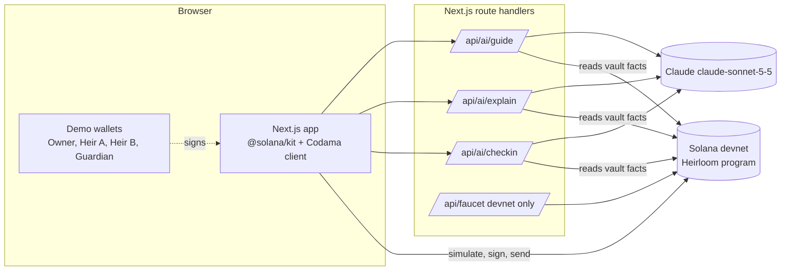
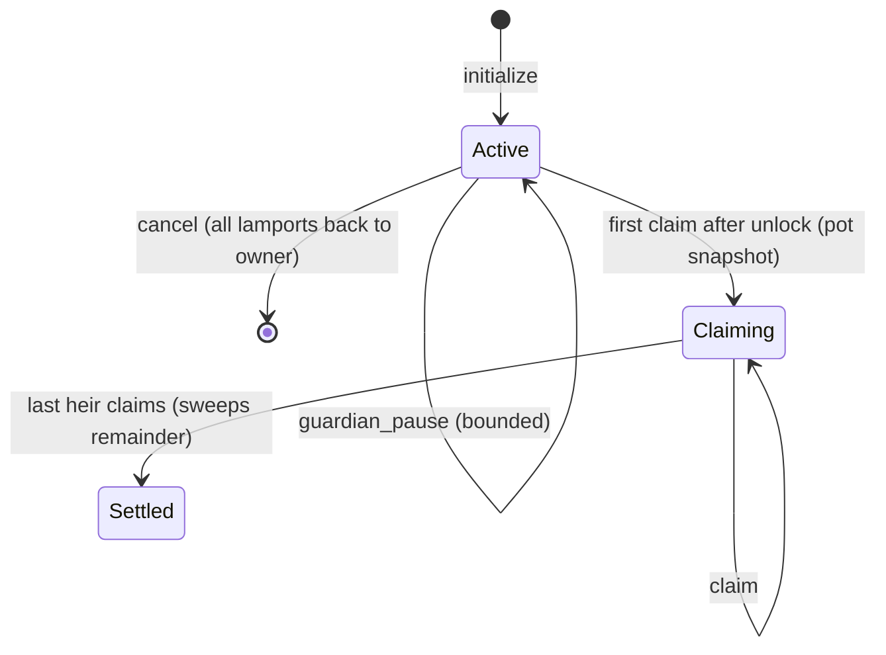

# Heirloom

A dead-man's switch for crypto inheritance on Solana. You lock SOL in a program-owned vault and name your heirs. Then you check in from time to time. If you stop checking in, the timer runs out, and after a grace period each heir can claim their share. Claude is the check-in companion: it writes the nudge and explains every transaction in plain words before you sign. It can never move funds or reset the timer.

> Prototype on Solana **devnet** with test SOL. Not a legal will, not financial advice.

- Program (devnet): `2GvFQtnM7cGaM9wso5iw6nMH5abo2aYKJRneZiWbQbKv` ([Explorer](https://explorer.solana.com/address/2GvFQtnM7cGaM9wso5iw6nMH5abo2aYKJRneZiWbQbKv?cluster=devnet))
- Live demo: https://heirloom-nine-gray.vercel.app
- Deploy tx (devnet): [2iynxBB…62o91](https://explorer.solana.com/tx/2iynxBBvwmCJz4pghus6bQo6vQbZqYMbw1NhgmHqnJk73oBH8WPUDY4VfcrGXoKhD4G9abeRkGJY4SwTTL562o91?cluster=devnet), IDL published on-chain
- Example demo vault on devnet: [A943…6xxb](https://explorer.solana.com/address/A943ZDs8jAjxLx3NzgZWDVDU5u2LpwhLNCvAbfQp6xxb?cluster=devnet) (created, checked in, guide sealed, guardian pause, two claims)
- Built for the MLH Solana Hackathon (Nov 6 to 8, 2026) by Seunghyeon Baek

## What it does

| Role | Can do | Can never do |
|---|---|---|
| Owner | create the vault, deposit, withdraw, check in, change heirs or timing, seal a handoff-guide hash, close the vault | anything after the first heir claims |
| Heartbeat relay (optional key) | `heartbeat` only | withdraw, change config, close |
| Guardian (optional) | delay the unlock, at most 30 days per pause and 3 pauses per check-in period | move funds, claim, change config |
| Heir | claim their share once, after `last_check_in + interval + grace` (and after any guardian pause) | claim twice, claim early, take another heir's share |

Every owner-signed instruction counts as proof of life and restarts the timer. The first claim freezes the pot, so every share is computed on the same balance. The last heir also gets the rounding dust and any SOL sent straight to the PDA.

## Architecture



- `programs/heirloom`: the Anchor 1.2.1 program in Rust.
- `app/src/generated`: a Kit client that Codama generates from the Anchor IDL (`npm run codegen`).
- `app/src/lib/heirloom.ts`: shared helpers for the PDA, fetch and decode (with an owner check), the vault view and the instruction builders.
- `app/src/lib/tx.ts`: the transaction path: build, then `simulateTransaction`, then the user approves, then sign, send and confirm. It also reads the clock from the Clock sysvar.
- `app/src/app/api/ai/*`: the Claude calls. The server reads the vault from chain itself, so the browser cannot feed the model false numbers. The model gets those facts as tagged JSON data.

### Vault PDA

```
seeds = ["vault", owner_pubkey]      program = 2GvF...bKv      size = 371 bytes

Vault {
  owner, heartbeat_authority, guardian: Option<Pubkey>,
  heirs: Vec<{ key, share_bps }> (1..=5, sum = 10_000),
  checkin_interval_secs, grace_period_secs, last_heartbeat, created_at,
  paused_until, pauses_used, status: Active | Claiming | Settled,
  claimed_bitmap: u8, claim_snapshot, claimed_total, guide_hash: [u8; 32], bump
}
lamports = rent-exempt minimum + the protected SOL
```



### Instructions

`initialize(heirs, interval, grace, guardian?, heartbeat_authority?)`, `deposit(amount)`, `heartbeat()`, `withdraw(amount)`, `update_config(...)`, `set_guide_hash(hash)`, `cancel()`, `guardian_pause(secs)`, `claim()`.

## Security notes

- Signer and authority checks are Anchor constraints. Owner instructions derive the PDA from the signer's key (`seeds = ["vault", owner]` plus `has_one = owner`), so another wallet cannot point at someone else's vault. `heartbeat` takes the owner or the relay key only. `guardian_pause` requires `vault.guardian == Some(signer)`.
- Account type and owner checks: `Account<Vault>` checks the discriminator and program ownership. A test copies the vault's bytes into a system-owned account and shows the program rejects it.
- Arithmetic uses checked math throughout, and shares are computed in u128. `overflow-checks = true` is set in release builds.
- Double claims are blocked by a claimed bitmap. Each claim sets its bit before any lamports move.
- Rent: withdrawals and claims never go below the rent-exempt minimum. The vault ends with exactly that minimum, and a test asserts it.
- The heir share base is frozen at the first claim. After that, deposits and owner actions are rejected.
- The guardian can delay heirs by at most about 90 days in total (3 pauses of up to 30 days each). The counter resets only when the owner checks in. The guardian never touches funds.
- The relay key can only call `heartbeat`. If it leaks, the worst case is that an attacker keeps the vault alive and delays inheritance. Funds cannot move. The owner can rotate it with `update_config`.
- The AI layer has no keys and no signing power. Claude only explains and nudges, and only a wallet signature changes state. The guide endpoint refuses text that looks like a seed phrase or private key. Only the guide's SHA-256 goes on-chain.

## Run and test

Requirements: Rust (the toolchain is pinned in `rust-toolchain.toml`), Solana CLI 4.x, Anchor CLI 1.2.1, Node 20.18+ and Surfpool 1.5.

```bash
# program + 18 LiteSVM tests
NO_DNA=1 anchor test --skip-deploy   # Anchor.toml targets devnet; --skip-deploy keeps tests local

# end-to-end test through the generated Kit client on an embedded Surfpool surfnet
cd app && npm install && npm run test:surfpool

# regenerate the TypeScript client after changing the program
anchor build && (cd app && npm run codegen)

# local app against a local surfnet
surfpool start --offline --no-tui --no-deploy -a <your-throwaway-pubkey>
solana program deploy target/deploy/heirloom.so --program-id <program-keypair> --url http://127.0.0.1:8899 --keypair <throwaway>
cp app/.env.example app/.env.local   # set ANTHROPIC_API_KEY, FAUCET_SECRET_KEY, NEXT_PUBLIC_RPC_URL
cd app && npm run dev
```

Devnet deploy (throwaway key, explicit flags on every command):

```bash
solana program deploy target/deploy/heirloom.so --program-id .keys/program-keypair.json \
  --url devnet --keypair .keys/deployer.json
```

Test coverage (`programs/heirloom/tests/vault.rs`): config storage; bad shares, zero share, duplicate heir, owner as heir, too many heirs, interval and grace bounds, re-initialisation; withdraw limits and rent floor; non-owner withdraw and deposit; heartbeat by the owner and relay vs. strangers; the relay cannot withdraw, update or cancel; the exact unlock boundary (t-1 fails, t succeeds); the 60/40 split with odd lamports, double claim, non-heir and settled; owner and guardian powers ending after the first claim; owner activity reviving an expired but unclaimed vault; stray lamports going to the last heir; guardian pause bounds, count and inability to move funds; heartbeat clearing pauses; update validation; guide hash owner-only; cancel refund and re-create; a fake vault owned by another program; five heirs claiming in any order with an exact total.

## Honest limitations

- Devnet prototype, with no audit. Do not use it with real funds.
- Liveness is a heuristic. A missed check-in does not prove death, and the grace period, guardian pause and owner's power to revive (any owner action before the first claim) exist to limit false unlocks. The flip side is that an owner who can still sign can always stop the inheritance before the first claim.
- Native SOL only. SPL tokens (for example USDC) are not supported yet.
- One vault per owner (the PDA is keyed by the owner). A settled vault keeps its rent-exempt lamports. Closing settled vaults is not implemented.
- The demo uses four throwaway keypairs kept in browser `localStorage`, so judges can play every role without installing a wallet. A real Wallet Standard wallet (Phantom, Solflare and so on) can also connect and act as the owner ("Use my wallet"). That path is implemented, but it was not tested with a real extension: the test browser had none installed.
- The handoff guide text is stored only in the browser in this prototype. The chain holds only its SHA-256. A production version would encrypt it to the heirs, store it off-chain, and release it after a claim.
- The check-in is in-app chat. It does not send email or Telegram reminders yet, and there is no scheduled relay. The `heartbeat_authority` relay key is supported and tested on-chain, but the hosted relay is not wired up.
- Rate limiting on the API routes is in-memory per server instance (best effort).
- The faucet route tops up demo wallets from a throwaway devnet key and is disabled when that key is unset.
- This is not a legal will and it does not replace inheritance law in any jurisdiction.

## Built with

Anchor 1.2.1, LiteSVM 0.18, Surfpool 1.5, @solana/kit 8.6, Codama, Next.js 16 and the Anthropic TypeScript SDK (Claude `claude-sonnet-5-5`). The fonts are General Sans (Fontshare) and Geist Mono. Templates and libraries are listed in `app/package.json` and `Cargo.toml`. All Heirloom code was written during the hackathon window, starting Nov 6, 2026 12:00 ET.

## License

MIT
